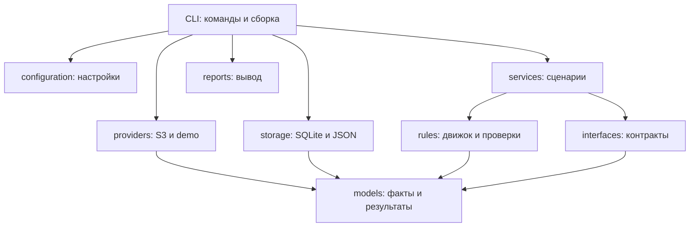

# Как устроено приложение и почему

Cloud Audit — один Python-пакет `cloud_audit`, один локальный процесс и одна консольная точка входа. Каталоги внутри пакета группируют код по назначению. Отдельных серверов и микросервисов нет.

## Карта кода

| Каталог/файл | Что находится внутри | Почему выделено |
|---|---|---|
| `cli.py`, `__main__.py` | Команды, сборка зависимостей, представление результата и exit code | Правило не должно разбирать аргументы консоли |
| `configuration/` | Переменные окружения и пользовательская политика аудита | Ошибки конфигурации отделены от сетевых сбоев; SDK не ищет ключи неявно |
| `models/` | Неизменяемые структуры: бакет, снимок, политика, находка, отчёт, история | Данные можно передавать между сценариями без привязки к boto3 или БД |
| `rules/` | Восемь правил, анализ грантов, движок и риск | Проверки можно воспроизводить над сохранёнными фактами без сети |
| `services/` | Подключение, сбор снимка, аудит, история и сравнение | Здесь определяется последовательность работы, а не формат хранения или SDK-запрос |
| `providers/` | S3, нормализация ответов, unsigned-пробы, демонстрационный профиль | Особенности провайдера не проникают в движок правил |
| `storage/` | SQLite, JSON, проверки схем и каталоги состояния | Данные сохраняются и проверяются одинаково для CLI и будущих интерфейсов |
| `reports/` | Фильтры представления, Markdown и экспорт | Отбор строк для просмотра не меняет сохранённые факты |
| `interfaces.py` | Protocol-контракты зависимостей | Сервис принимает нужные операции, а не создаёт SDK/SQLite самостоятельно |
| `errors.py` | AuditError и ConfigurationError | Общие ошибки не требуют импорта сервиса или адаптера |

Старые `domain`, `application`, `infrastructure` заменены указанными предметными названиями. Принципы Clean Architecture сохранены: зависимости от внешних инструментов идут через контракты к моделям и логике, независимо от названий каталогов.

Стрелки показывают основные зависимости. `storage/report_schema.py` использует строгий парсер политики из `configuration/policy.py`; это валидация формата, не выполнение аудита. Внешние реализации структурно удовлетворяют Protocol без обязательного наследования.

## Путь запроса

1. `__main__.py` вызывает `cli.main()`. `build_parser()` проверяет синтаксис аргументов; справка/версия завершаются до подготовки файлов и облачных клиентов.
2. CLI проверяет сочетания профиля, снимка и проб; загружает Settings и вызывает EnvironmentService. LocalStateStorage готовит закрытые каталоги.
3. Только живые сетевые команды профиля vk создают S3Provider. Чтение отчётов, история, сравнение и офлайн-аудит не создают SDK-клиент и не требуют ключей.
4. SnapshotService фиксирует начало сбора, получает наблюдения через ConfigurationCollector, вычисляет охват/полноту и сохраняет снимок. Снимок содержит факты, а не утверждение о безопасности.
5. SecurityAuditService передаёт снимок и AuditPolicy в RuleEngine. Движок возвращает Finding каждого выбранного правила.
6. Сервис объединяет ограничения, добавляет namespace/версию алгоритмов и сохраняет самодостаточный SecurityReport v3.
7. CLI выдаёт JSON/текст. Report/history/compare могут сформировать Markdown или новый экспортный файл. Исходный evaluation_status сохраняется при фильтрации.

## Ступенчатый многоцелевой сценарий

ScanService оркестрирует независимые внешний и внутренний этапы через ExternalInspection, ScanProvider и ScanRunRepository. ExternalInspector отвечает за unsigned-факты, MutationProber — за искусственные цели/эффект/уборку, ObjectEnumerator — за ограниченное перечисление. Сводки хранятся JsonScanRepository отдельно от прежних SQLite-отчётов. После внешних проб SnapshotService.enrich сохраняет новый воспроизводимый снимок перед обычным SecurityAuditService. CLI-сборка нового сценария находится в scan_cli.py, форматирование — reports/scanning.py. Полный контракт и режимы — [STAGED_SCAN.md](STAGED_SCAN.md).

## Где находится логика

- **Модель** хранит значения и локальные инварианты. Например, CollectionOptions проверяет размер явного охвата, но не вызывает сеть.
- **Правило** принимает снимок и политику, возвращает находку. Оно не должно читать `.env`, создавать клиент, изменять бакет или сохранять отчёт.
- **Движок** решает вопросы, общие для правил: выбор ID, применимость, недоступность обязательных источников, срок исключения.
- **Сервис** определяет сценарий работы: какие действия и в какой последовательности выполняются.
- **Адаптер провайдера** переводит внешние ответы и ошибки в независимые структуры. Неизвестный API не означает безопасную конфигурацию.
- **Репозиторий** сохраняет/читает данные и проверяет их целостность. Отказ чтения не превращается в пустой успешный результат.

## Контракты зависимостей

| Protocol | Кто использует | Текущая реализация |
|---|---|---|
| StorageProvider | ProfileService для connection/resources | S3Provider, DemoProvider |
| SimulationProvider | Только демонстрационная ветка ProfileService.simulate | DemoProvider |
| ConfigurationCollector | SnapshotService | S3Provider; S3ConfigurationCollector в тестах |
| SnapshotRepository | SnapshotService | JsonSnapshotRepository |
| SecurityRule | RuleEngine | VersioningRule, PublicAccessRule ×4, три governance-правила |
| SecurityReportRepository | SecurityAuditService | SqliteReportRepository; JsonReportRepository совместимо |
| ReportRepository | ProfileService | SqliteReportRepository с JSON fallback |
| AuditHistoryRepository | AuditHistoryService | SqliteReportRepository |
| StateStorage | EnvironmentService | LocalStateStorage |

ProfileService.simulate проверяет `mode=demo` до вызова демонстрационного контракта. У S3Provider нет бессмысленного preview и флага «аудит ещё не реализован». Настоящая проверка всегда идёт через SecurityAuditService.

## Решения и компромиссы

**Неизменяемые dataclass.** Упрощают передачу контекста и сравнение. Вложенные dict технически остаются изменяемыми; код не должен менять переданный снимок после сохранения. Фильтры отчёта работают с отдельной копией через asdict.

**Последовательный сбор.** Проще контролировать ошибки и нагрузку на API. Это не атомарное состояние облака: collected_at — начало серии запросов, соответствующее ограничение сохраняется.

**SQLite плюс JSON-снимки.** История требует индексов, транзакций и фильтров; входные снимки удобны как ограниченные по сроку воспроизводимые JSON. Перенос модулей не изменил пути файлов или схемы данных.

**Сохранённый отчёт самодостаточен.** Доказательства, политика и ограничения входят в него: сравнение не требует живого бакета или непросроченного снимка. Новый офлайн-аудит требует действительного снимка.

**Консервативная интерпретация.** Полного IAM-интерпретатора нет. Condition/Not*, скрытые внутренние права и незаданные объекты отмечаются как ограничения. Уверенный положительный unsigned-запрос — отдельное доказательство конкретной операции.

**Demo сохранён намеренно.** Он даёт проверяемый запуск без облака, явно помечен simulated и не участвует в сравнении настоящих отчётов. Чтение JSON сохранено ради уже накопленных данных и импорта.

## Как расширять

Новое правило: добавить класс с контрактом SecurityRule в `rules/`, карточку с угрозой/источниками/границами и тесты; зарегистрировать в `rules/registry.py`. Если меняется смысл существующих результатов, повысить CURRENT_RULESET_VERSION; при изменении формата данных добавить совместимую версию схемы, а не только новое имя файла.

Новый провайдер: реализовать получение независимых наблюдений и namespace в `providers/`, подключить в точке сборки. Семантику его ACL нельзя автоматически считать совпадающей с VK S3: правила нужно отдельно проверить.

Другой интерфейс запуска: вызывать те же сервисы с внедрёнными реализациями. Не переносить в него алгоритмы правил. Веб-интерфейс и ИИ пока не реализованы; выбор Cloud.ru/MCP/Docker относится к итерации 12.

Полный перечень файлов, классов, методов, аргументов и констант: [CODE_REFERENCE.md](CODE_REFERENCE.md).
